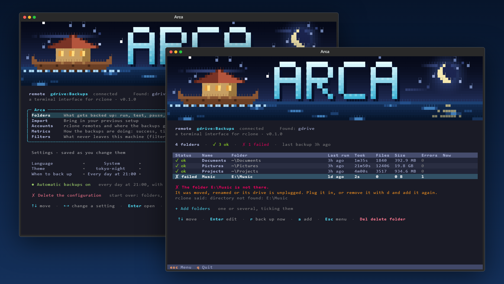

<div align="center">


<br><br>

[](#roadmap)
[](https://www.python.org/)
[](https://textual.textualize.io/)
[](https://rclone.org/)
[](#requirements)
[](LICENSE)

### Your data, where you decide, the way you decide.

A terminal interface for `rclone` on Windows.<br>
Choose what gets backed up, see what it weighs before it uploads, and never lose a file.

</div>

---



---

## The brief

Google Drive for desktop and OneDrive back up everything they are pointed at. A folder of code projects goes up with every `node_modules`, the free plan fills with files that can be rebuilt in seconds, and there is no switch for "this, but not that". You do not choose what goes, where it lands, or what happens when something is deleted on your computer: it is deleted in the cloud too.

Arca hands that control back. You pick the folders, and inside each one the files: every tick shows how much the backup will hold against what the folder weighs, and the Metrics page shows the space left on the account, so a backup never runs into the plan's limit by surprise. Everything lands as plain folders in your own account (`Backups/Documents`), readable without Arca, and anything overwritten or deleted is set aside in `_versions/` first. When something breaks, an expired login, a full drive, an unplugged disk, Arca says what happened and how to fix it, on screen, never only in a log.

## Under the hood

Arca does not move a single byte itself. [rclone](https://rclone.org/) does: it speaks to Google Drive, OneDrive, Dropbox, Backblaze and seventy other storage services, and has no interface, no memory and no overview. Arca is that missing layer, in Python with [Textual](https://textual.textualize.io/).

Every backup is an `rclone sync` with `--backup-dir`: the destination mirrors the folder, and nothing is ever deleted without being archived first. What stays home is data, not code: a shared `filter.txt` and each folder's own ticks. rclone's JSON log is read line by line into live progress and into a cause and a fix for every failure. Accounts are signed in through the browser without `rclone config`, and automatic backups are a Windows Task Scheduler task that runs with no window and needs no administrator.

Keyboard first: arrows move, Enter opens, Esc goes back, and the tests drive the app the same way, by keys only. Architecture, conventions and open work: [CLAUDE.md](CLAUDE.md).

## Roadmap

| | Stage | |
|---|---|---|
| 1 | Backup engine: sync with a versions archive, filters, history, causes and fixes |  |
| 2 | The interface: home menu, folders, live progress, each folder's own screen |  |
| 3 | Choosing folders and files, importing an older setup, metrics |  |
| 4 | Automatic backups: at sign-in or every day, no window |  |
| 5 | A Windows notification when an unattended backup fails |  |
| 6 | Accounts without `rclone config`: Drive, OneDrive, Dropbox and Photos are in; Backblaze, S3 and local disks next |  |
| 7 | Versions browser: restore a file or a folder from `_versions/` |  |

## Requirements

- Windows, Python 3.11+ and [uv](https://docs.astral.sh/uv/).
- [rclone](https://rclone.org/downloads/) on `PATH`: `winget install Rclone.Rclone`.
- An account to back up to, added from Arca itself, or a local disk.

```powershell
uv run arca                  # open the interface
uv run arca run --dry-run    # what a backup would change, changing nothing
```

## Credits

The interface follows the design of [Bitácora](https://github.com/baltazarandersson/bitacora) by Baltazar Andersson, with his permission.

## License

[MIT](LICENSE) &copy; 2026 [Luis Barral](https://barral.dev). Free to use, change and share.

<div align="center">

**[Luis Barral](https://barral.dev)** &middot; MIT

<a href="CLAUDE.md"></a>

</div>
